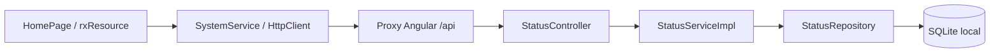

# Arquitectura de la base

## Correspondencia con la referencia

Se contrastaron las guías con los archivos reales. La referencia contiene guías y fragmentos, no dos aplicaciones completas: no tiene `package.json`, `build.gradle`, Java compilable ni una conexión Angular/Spring implementada. El servicio Simpsons incluso usa operadores sin importar; se reutiliza su separación de responsabilidades, no se copia su código sin revisión.

| Referencia | Aplicación nueva | Estado |
| --- | --- | --- |
| `angular/A3-naming/A3-naming.md` | `src/app/features/<dominio>/` | Organización por feature y nombres modernos |
| `07-consumo-servicios-http/files/simpsons.service.ts` | `features/system/services/system.service.ts` | `HttpClient`, `inject()`, Observable e interfaz |
| `07-consumo-servicios-http/files/simpsons-page.ts` | `features/system/pages/home-page/` | `rxResource`, OnPush y estados de carga/error |
| `03-Navegacion/03-Navegacion.md` | `app.routes.ts`, `app.config.ts` | Router standalone y carga diferida de la página |
| `spring-boot/02_estructura_proyecto.md` | `backend/src/main/java/ec/edu/ups/reservas/` | Paquetes por dominio; nombres de capas en plural |
| `04_servicios.md` | `system/services/StatusService{,Impl}.java` | Interfaz/implementación e inyección por constructor |
| `05_repositorios_persistencia.md` | Starter JPA, SQLiteDialect, SQL y `system/repositories/` | Motor adaptado a SQLite por el PDF |
| `07_control_errores.md` | `core/exceptions/{handler,response}/` | Respuesta uniforme 503 para fallas de datos |
| `11_autenticacion_autorizacion.md` | Futuro `security/` | Pendiente: autenticación local y roles |

## Estructura implementada

```text
reservas-laboratorio/              # nombre de carpeta existente; aplicación: reservas-laboratorios
├── AGENTS.md
├── README.md
├── angular.json, package.json, package-lock.json, proxy.conf.json
├── src/
│   ├── environments/environment.ts
│   └── app/
│       ├── app.ts, app.html, app.css, app.routes.ts, app.config.ts
│       ├── core/                 # reservado para configuración/auth transversal
│       ├── shared/               # reservado para piezas comunes reales
│       └── features/
│           ├── system/           # único módulo ejecutable de esta etapa
│           │   ├── pages/home-page/
│           │   ├── services/
│           │   └── interfaces/
│           ├── auth/, users/, laboratories/, equipment/
│           └── schedules/, reservations/, incidents/, notifications/, reports/
├── backend/
│   ├── build.gradle, settings.gradle, gradlew, gradlew.bat
│   ├── gradle/wrapper/            # incluye JAR; se versiona
│   ├── data/.gitkeep              # SQLite generado, no se versiona
│   └── src/
│       ├── main/java/ec/edu/ups/reservas/
│       │   ├── ReservasApplication.java
│       │   ├── core/exceptions/{handler,response}/
│       │   ├── system/{controllers,services,repositories,dtos}/
│       │   └── security/, users/, laboratories/, equipment/, schedules/,
│       │       reservations/, incidents/, notifications/, reports/
│       ├── main/resources/application.yml
│       ├── main/resources/db/{schema,seed}.sql
│       └── test/java/ec/edu/ups/reservas/BaseIntegrationTest.java
└── docs/
```

Los directorios futuros contienen `.gitkeep`, no funcionalidades ficticias. Al iniciar un dominio se crean `pages`, `services`, `interfaces` en Angular y `controllers`, `services`, `repositories`, `entities`, `dtos`, `mappers` en Java según lo que necesite. No se añaden modelos separados o mappers hasta que exista una conversión real.

## Flujo ejecutable



`GET /api/status` devuelve `{"application":"reservas-laboratorios","status":"UP","database":"UP"}` solo si puede consultar la semilla técnica de SQLite. Si hay un error de datos responde 503 sin exponer SQL o rutas locales. Es un diagnóstico público local; no sustituye la autenticación pendiente.

El repositorio técnico usa `JdbcTemplate` parametrizado para una consulta escalar; no se inventa una entidad de negocio solo para probar conexión. JPA/Hibernate está configurado y comprobado; los futuros repositorios de dominio seguirán `JpaRepository<Entity, Long>` de la referencia. El DTO de estado es un record Java por su carácter inmutable y pequeño.

## Configuración y persistencia

- Navegador: `http://localhost:4200`; petición relativa `/api/status`.
- Desarrollo: proxy a `http://127.0.0.1:8080`. No requiere CORS abierto.
- Backend escucha en loopback; puerto configurable con `PORT`.
- SQLite: `backend/data/reservas.db` al ejecutar desde `backend/`. `DB_URL` permite otra ruta; su carpeta debe existir.
- `schema.sql` crea solo `app_metadata`; `seed.sql` agrega `schema_version=base-1` sin duplicarla. Se aplican al arrancar. Todavía no hay tablas de negocio ni usuarios de prueba.
- Hibernate no altera el esquema (`ddl-auto: none`); llaves foráneas activas, espera de bloqueo 5 segundos y pool de una conexión para este servidor local.
- Producción no es parte de esta base. El proxy de Angular solo existe en desarrollo: una futura publicación necesitará servir `/api` bajo el mismo origen o configurar URL y CORS explícitos.

## Integración en pareja

Ambos flujos de reservas usarán la misma entidad, API y política de disponibilidad. Integrante 1 mantiene estados/aprobación/notificaciones y el contrato común de `reservations`; integrante 2 mantiene disponibilidad y adapta sobre ese contrato el flujo estudiantil. Cambios en SQL, contratos o archivos globales requieren coordinación previa; no se crearán dos motores de reservas.
