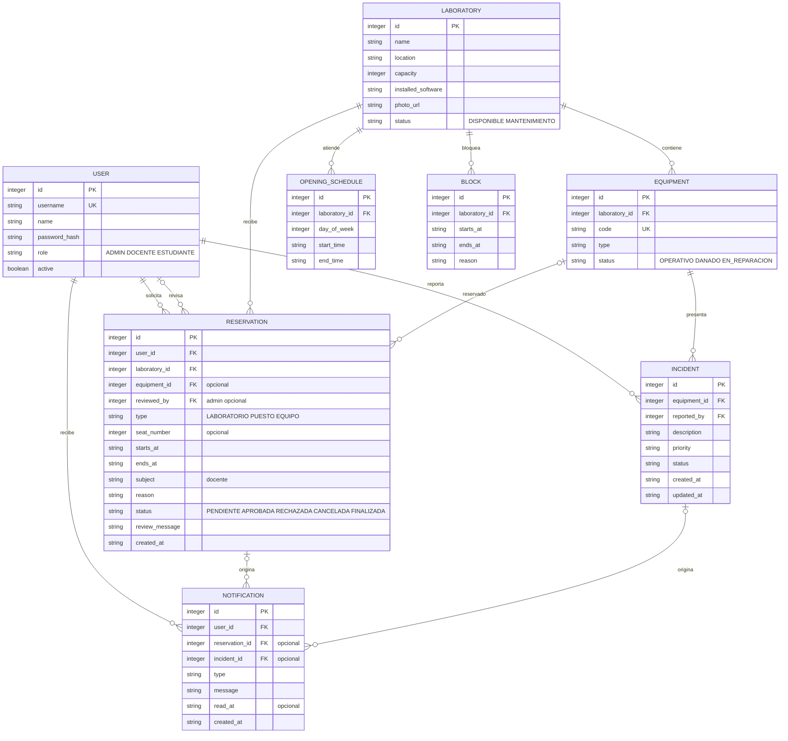

# Modelo entidad-relación conceptual inicial

Fuente: `REQUISITOS_PROYECTO.pdf`, pp. 2-3. Es una propuesta para revisión de ambos integrantes; todavía no es el esquema implementado. Hoy solo existe `app_metadata`, tabla técnica ajena al dominio. Las tablas descritas se crearán mediante SQL y entidades al desarrollar cada módulo.

## Criterios para implementarlo

- Un usuario tiene un solo rol inicial. Un enum/String controlado es suficiente para estos tres roles. La referencia usa tabla de roles; si se necesita multirol, adaptar a `roles` y `user_roles` antes de implementar seguridad. No hay requisito oficial de multirol.
- `username` es único, contraseña solo en `password_hash`. Seed futuro con hash generado por el mismo algoritmo del login; documentar usuarios de demostración sin usar contraseñas personales.
- Software se propone como texto y foto como URL/ruta de recurso; el PDF no exige inventario normalizado de software ni un servicio externo de imágenes.
- Franjas de atención recurrentes semanales y bloqueos con fecha son entidades distintas. Propuesta simple: materializar las ocurrencias de clases fijas como bloqueos fechados. Validar límites de día e intervalos inicio < fin.
- Fechas de reservas/bloqueos como instantes UTC en ISO-8601; mostrar y evaluar horarios recurrentes en `America/Guayaquil`. Evitar almacenar fechas ambiguas según el formato regional de Windows.
- Reserva completa: docente, asignatura/motivo y estado inicial PENDIENTE. Estudiantil: PUESTO o EQUIPO, estado APROBADA solo si pasa todas las validaciones.
- Propuesta para puesto: número entre 1 y la capacidad, sin entidad extra. Confirmar si se requiere inventario físico de puestos; en ese caso crear `seats` y FK antes de su CRUD. Una reserva EQUIPO exige `equipment_id` del mismo laboratorio; una PUESTO exige `seat_number`; una completa no lleva ninguno.
- Un único motor comprueba cruces usando intervalos semiabiertos `[inicio, fin)` (permite reservas consecutivas), horarios de atención, bloqueos, estado del laboratorio/equipo, fecha no pasada y capacidad.
- APROBADA consume cupo. Propuesta: PENDIENTE no consume cupo y al aprobar se vuelve a validar en la misma transacción; si ya hay reservas estudiantiles, impedir aprobar laboratorio completo mientras existan conflictos. El PDF no define la prioridad en ese caso: revisar esta política con ambos/docente.
- Usuario solo cancela sus reservas antes del inicio; ambos roles tienen historial. Aprobación/rechazo registra administrador y mensaje. APROBADA pasa a FINALIZADA al terminar; definir tarea periódica de Spring y reconciliación al iniciar para cubrir periodos con servidor apagado.
- Docentes y estudiantes reportan incidencias de equipos; administrador gestiona su estado. El PDF no fija los valores de prioridad/estado de incidencia: acordarlos antes de codificar. No atribuirle enums inventados.
- Notificaciones internas por destinatario, vinculadas opcionalmente a reserva o incidencia. Los reportes se calculan con consultas, sin una tabla propia: ocupación por laboratorio y ranking de equipos con incidencias. Definir rango de fechas/denominador de ocupación antes del reporte.

## Restricciones y pruebas futuras

FK activas, códigos/usernames únicos, capacidad positiva y checks de tipo/estado/fechas en SQL cuando correspondan. Las restricciones temporales de reservas requieren servicio transaccional y pruebas de solicitudes simultáneas: una consulta de disponibilidad desde Angular no impide dobles reservas. Documentar la política de borrado de usuarios/laboratorios con historial; preferir desactivación antes de borrar referencias históricas.

Antes de la primera entidad: revisar este modelo juntos y actualizar SQL, DTO e interfaz Angular de forma coordinada. No generar todo el modelo Java solo por estar dibujado.
